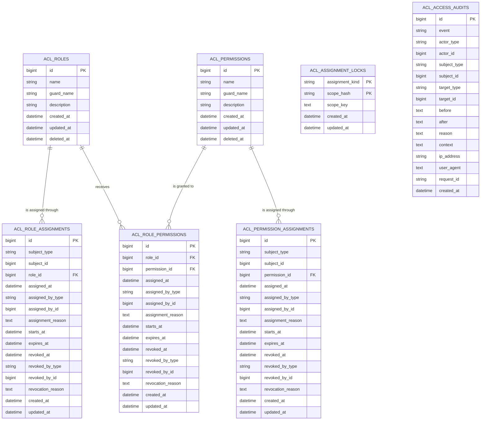

# GateTrail Initial Entity-Relationship Diagram

- Status: Draft for review
- Date: 2026-07-28
- Scope: Initial numeric-identifier schema

## 1. Purpose

This document translates the accepted GateTrail data model into an initial
database-neutral ERD.

It is the baseline for migrations, models, constraints, and database-specific
schema validation. It does not replace `PACKAGE_SPEC.md` or the accepted ADRs.

## 2. Relationship overview



The diagram shows physical foreign-key relationships only. Polymorphic
application references are described separately because their target tables
belong to the consuming application.

## 3. Physical relationships

| Parent | Child | Child column | Cardinality |
|---|---|---|---|
| `acl_roles` | `acl_role_assignments` | `role_id` | One role to zero or many assignment records |
| `acl_permissions` | `acl_permission_assignments` | `permission_id` | One permission to zero or many direct assignment records |
| `acl_roles` | `acl_role_permissions` | `role_id` | One role to zero or many permission-grant records |
| `acl_permissions` | `acl_role_permissions` | `permission_id` | One permission to zero or many role-grant records |

Each child record references exactly one parent definition. Role and permission
definitions use soft deletion, while assignment history is retained.

The migration implementation must use explicit foreign-key names of 30
characters or fewer. Delete actions will be finalized during migration review;
they must not introduce cascading deletion of assignment history.

## 4. Logical polymorphic references

These pairs refer to models owned by the consuming application and therefore
do not have physical database foreign keys:

| Table | Reference |
|---|---|
| `acl_role_assignments` | `subject_type`, `subject_id` |
| `acl_role_assignments` | `assigned_by_type`, `assigned_by_id` |
| `acl_role_assignments` | `revoked_by_type`, `revoked_by_id` |
| `acl_permission_assignments` | `subject_type`, `subject_id` |
| `acl_permission_assignments` | `assigned_by_type`, `assigned_by_id` |
| `acl_permission_assignments` | `revoked_by_type`, `revoked_by_id` |
| `acl_role_permissions` | `assigned_by_type`, `assigned_by_id` |
| `acl_role_permissions` | `revoked_by_type`, `revoked_by_id` |
| `acl_access_audits` | `actor_type`, `actor_id` |
| `acl_access_audits` | `subject_type`, `subject_id` |
| `acl_access_audits` | `target_type`, `target_id` |

Morph maps are recommended so persisted type values do not depend permanently
on PHP class names.

## 5. Assignment lifecycle

The three assignment tables preserve history:

```text
Scheduled → Active → Expired
                   └→ Revoked
```

An assignment is active at time `T` when:

```text
revoked_at IS NULL
AND (starts_at IS NULL OR starts_at <= T)
AND (expires_at IS NULL OR expires_at > T)
```

Expiry is exclusive. Revocation changes the existing history record;
reassignment creates a new record.

## 6. Coordination rows

`acl_assignment_locks` has no foreign keys. Its composite primary key is:

```text
(assignment_kind, scope_hash)
```

One persistent coordination row serializes mutations for an equivalent
assignment scope:

| Assignment kind | Scope |
|---|---|
| Role assignment | Subject type, subject ID, and role ID |
| Direct permission assignment | Subject type, subject ID, and permission ID |
| Role-permission assignment | Role ID and permission ID |

`scope_key` retains the canonical unhashed key for collision detection.
Coordination behavior is defined by
[ADR 0001](../decisions/0001-unique-active-assignments.md).

## 7. Audit independence

`acl_access_audits` deliberately has no physical relationship to package
entities or application models. An audit record must remain readable even when
its actor, subject, or target is later unavailable.

The `before`, `after`, and `context` fields use portable text/CLOB storage.
Native JSON storage and database-specific JSON querying are not required by the
core design.

## 8. Portability rules

- Package-owned table, index, constraint, sequence, and trigger names must not
  exceed 30 characters.
- Numeric primary and morph identifiers use database-appropriate 64-bit
  compatible types.
- `acl_assignment_locks` uses a composite primary key and needs no sequence or
  trigger.
- Oracle package-managed and DBA-managed provisioning must represent the same
  logical model.
- MySQL, PostgreSQL, SQL Server, and Oracle must preserve the same assignment
  lifecycle and relationship behavior.
- SQLite represents the same logical design in automated package tests.

## 9. Migration review checklist

Before migrations are accepted:

1. finalize explicit index, unique-constraint, and foreign-key names;
2. confirm nullability and portable column sizes;
3. confirm non-cascading foreign-key delete behavior;
4. validate schema-qualified table handling;
5. validate Oracle sequence and trigger configuration;
6. verify migration and rollback behavior on every supported adapter.
